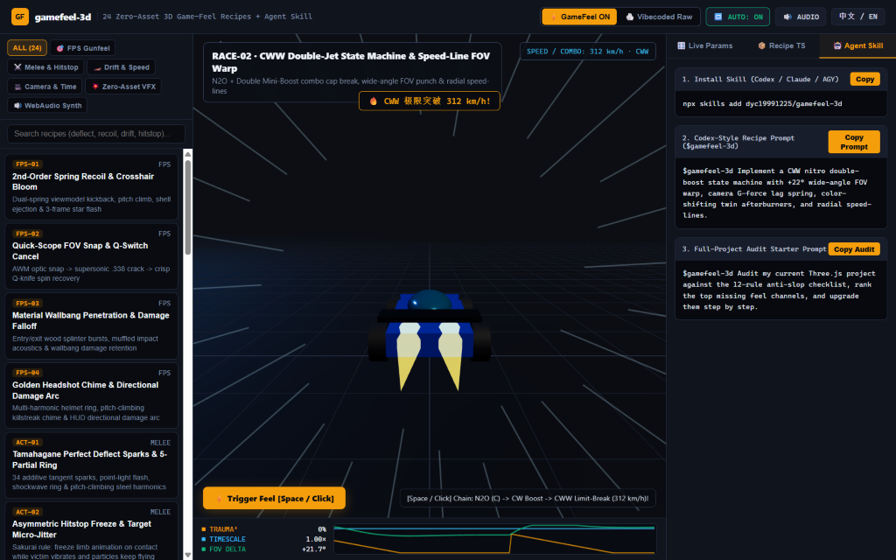

<p align="center">
  
</p>
<p align="center">
  
</p>

# gamefeel-3d ⚡

**24 zero-asset procedural 3D game-feel recipes in Three.js, GLSL & WebAudio — plus an Agent Skill that stops coding agents from shipping lifeless "plastic" 3D games.**

**24 个零外部资产（0 张贴图 / 0 个模型 / 0 段 MP3）的纯代码 Web 3D 游戏打击感与手感配方库 + 在线实时 A/B 对比实验室 + 跨平台 Agent Skill（支持 Claude Code、Codex、Antigravity、Cursor）。**

[**Live Interactive Studio**](https://dyc19991225.github.io/gamefeel-3d/) · [**Full 24-Recipe Catalog**](docs/CATALOG.md) · [**Agent Skill (`SKILL.md`)**](skills/gamefeel-3d/SKILL.md) · [**12-Rule Anti-Slop Checklist**](skills/gamefeel-3d/references/anti-slop-checklist.md)

---

## Why `gamefeel-3d`? / 为什么做这个项目？

AI coding agents can scaffold a playable Three.js prototype in two minutes — **and 95% of them feel like weightless plastic**:
- Shots decrement `hp -= 25` with zero viewmodel spring recoil, muzzle flash, or brass shell ejection.
- Camera shake uses `camera.position.x += (Math.random() - 0.5) * 0.5`, causing nauseating jitter instead of GDC-grade `shake = trauma²` rotational noise.
- Melee swings slice through enemies like air (missing Sakurai asymmetric hitstop, 2-frame white hit-flash, sub-stepped GLSL blade trails, and inharmonic steel partials).
- Arcade karts rotate rigidly along velocity vectors instead of decoupling slip angle with tiered drift sparks and wide-angle FOV warp.
- Audio is either dead silent or a microwave-timer `sine` beep.

`gamefeel-3d` fixes both sides of the problem:
1. **Interactive 3D Studio**: Flip **`⚡ GameFeel ON` ↔ `🪨 Vibecoded Raw`** in real time on all 24 acted-out 3D scenes, tune physics/shader/synth sliders, watch the live `Trauma² / TimeScale / FOV` oscilloscope, and copy standalone zero-dependency TypeScript snippets.
2. **Drop-In Agent Skill**: Give Claude Code, OpenAI Codex, or Google Antigravity battle-tested math, GLSL shaders, and zero-MP3 WebAudio synthesizers distilled from real FPS, Sekiro-like melee, and arcade kart engines.

---

## Install the Agent Skill / 一键安装 AI 技能

### Using `skills` CLI (Claude Code, Codex, Antigravity, Cursor)
```bash
npx skills add dyc19991225/gamefeel-3d
```

### Manual Copy
Copy [`skills/gamefeel-3d`](skills/gamefeel-3d) into your project or global skills folder:
- **Claude Code**: `.claude/skills/gamefeel-3d/`
- **Codex / Universal Agents**: `.agents/skills/gamefeel-3d/`
- **Antigravity**: `~/.gemini/antigravity/skills/gamefeel-3d/`

Once installed, invoke with Codex `$gamefeel-3d` starter prompts or natural language:

```text
# 1. Interactive Guided Audit (Codex / Claude Code / Antigravity)
$gamefeel-3d 对照 12 条反塑料感清单扫描我当前的 Three.js 项目，列出最缺失的手感通道并分步升级。

# 2. Sekiro Melee & Hitstop Pack
$gamefeel-3d 给我的近战战斗注入 34 颗火花完美弹反、65ms 非对称顿帧、子步插值 GLSL 刀光与零 MP3 玉钢刀鸣。

# 3. FPS Recoil & Sniper Pack
$gamefeel-3d 为步枪和狙击枪添加二阶弹簧后坐力、瞬狙开镜 Q 切取消后摇、木箱穿透衰减与连杀升调爆头叮声。

# 4. Arcade Drift & Speed Pack
$gamefeel-3d 实现车头/速度解耦漂移侧滑、蓝紫金三阶胎火、CWW 氮气广角畸变速度线与落地悬挂挤压。
```

---

## What's Inside / 6 大分类 · 24 个纯代码配方

| Category | Count | Highlights |
| :--- | :---: | :--- |
| **🎯 FPS Gunfeel & Ballistics** | 4 | 2nd-order under-damped recoil spring & crosshair bloom, AWM quick-scope FOV snap + `Q`-knife spin cancel, wood wallbang penetration falloff vs steel ricochet, pitch-climbing golden headshot ding + HUD directional damage arc |
| **⚔️ Melee, Deflect & Hitstop** | 5 | 34-spark Tamahagane perfect deflect (`铛！！`), Sakurai asymmetric hitstop + victim contact vibration, sub-stepped 5-style GLSL katana ribbon trail, HP-coupled posture break + bronze-gong Deathblow (`忍杀`), Perilous `"危"` sting + Mikiri blade stomp |
| **🏎️ Arcade Drift & Speed** | 4 | Decoupled nose-vs-velocity yaw drift + Blue/Purple/Gold spark tiers, `C -> CW -> CWW` nitro state machine + `+22°` FOV warp & radial speed-lines, counter-steer Cut-Drift (`断位拉车头`) snap, airborne pitch & volume-preserving landing suspension squash |
| **🎥 3D Camera & Time** | 4 | Squirrel Eiserloh's `trauma²` 3-axis rotational noise shake (with live comparison against bad `Math.random` jitter), Witch-Time `0.14×` slow-mo synced to a `680 Hz` WebAudio lowpass dive, zero-clipping crit Zoom-Punch + Dutch roll, `144Hz`-safe `damp()` follow + velocity lookahead |
| **💥 Zero-Asset Shaders & VFX** | 4 | GLSL Fresnel blast dome + ground shockwave ring, `45ms` Z-randomized 3-plane star muzzle flash + tracer + tumbling brass shells, stroked `CanvasTexture` parabolic 3D damage numbers, `60ms` pure-white arcade hit-flash + spring wobble |
| **🔊 Procedural WebAudio Synth** | 3 | Zero-MP3 firearm & `.50` cannon synth (`DynamicsCompressor` + hull impulse reverb), Sengoku inharmonic steel & Buddhist temple gong forge, click-free continuous 5-gear sawtooth RPM engine + `1950 Hz` tire screech |

See [`docs/CATALOG.md`](docs/CATALOG.md) for the complete index.

---

## Run the Interactive Studio Locally / 本地运行交互实验室

```bash
git clone https://github.com/dyc19991225/gamefeel-3d.git
cd gamefeel-3d
npm install
npm test        # Verify all 24 zero-asset recipes & skill files
npm run dev     # Launch live 3D studio
```

### Keyboard Shortcuts in Studio
- `Space` / Click Viewport — Trigger primary action (Fire / Deflect / Drift / Detonate)
- `Q` — Trigger secondary action (Quick-Switch / Mikiri Counter / Cut-Drift / Cycle Preset)
- `R` — Instant A/B toggle between **GameFeel ON** and **Vibecoded Raw**

---

## License

[MIT](LICENSE) © dyc19991225
