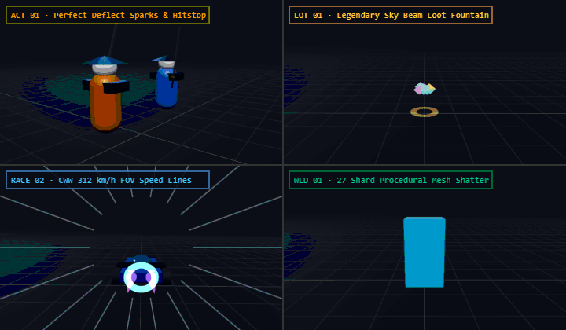
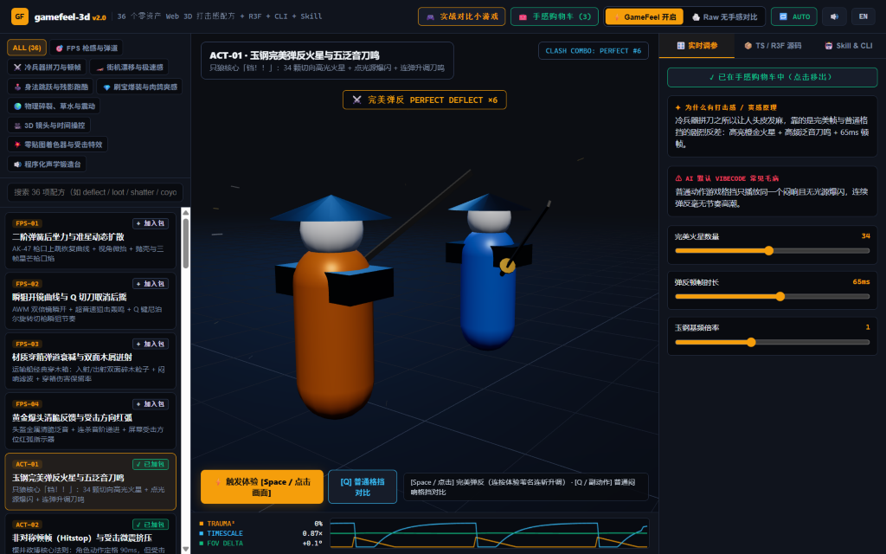

<p align="center">
  
</p>
<p align="center">
  
</p>

# gamefeel-3d ⚡ (v2.0)

**36 zero-asset procedural 3D game-feel recipes in Three.js, React Three Fiber, GLSL & WebAudio — plus a `doctor` CLI, Custom Kit Bundler, and Agent Skill that stops coding agents from shipping lifeless "plastic" 3D games.**

**36 个零外部资产（0 贴图 / 0 模型 / 0 段 MP3）的纯代码 Web 3D 打击感与手感配方库 + 实时前后对比小游戏 + 手感购物车单文件导出 + `doctor` 项目体检 CLI + 跨平台 Agent Skill（支持 Codex、Claude Code、Antigravity、Cursor）。**

[**Live Interactive Studio (36 Recipes)**](https://dyc19991225.github.io/gamefeel-3d/) · [**Play Before/After Arena Mini-Game**](https://dyc19991225.github.io/gamefeel-3d/demo.html) · [**Full 36-Recipe Catalog**](docs/CATALOG.md) · [**Agent Skill (`SKILL.md`)**](skills/gamefeel-3d/SKILL.md) · [**12-Rule Anti-Slop Checklist**](skills/gamefeel-3d/references/anti-slop-checklist.md)

---

## New in v2.0 / 完全体五大特性

1. **9 Categories · 36 Acted-Out Zero-Asset 3D Recipes** — Added **Platform & Parkour** (Coyote jump, Sandevistan dash ghosts, grapple swing, wall-run tilt), **Roguelite & Loot Dopamine** (Diablo sky-beam fountain, push-back XP magnet, level-up golden nova, chest anticipation), and **Destruction, Foliage, Water & Haptics** (27-shard mesh shatter, 1-drawcall GPU grass trample, analytic water ripples, Web Gamepad dual-rumble).
2. **🧰 Feel Kit Builder (`gamefeel-kit.ts` Bundler)** — Select any combination of recipes (or pick 1-click FPS / Sekiro / Roguelite / Kart starter packs) and download a single merged zero-dependency `gamefeel-kit.ts` or copy a combined multi-recipe `$gamefeel-3d` prompt.
3. **⚛️ Dual Code Output (`Vanilla Three.js` ↔ `React Three Fiber`)** — Switch every recipe between standalone `.ts` and idiomatic `@react-three/fiber` `useFrame` `.tsx` components.
4. **🩺 `gamefeel-3d doctor` CLI Health Grader** — Scan any local Three.js / R3F project to catch `Math.random()` camera-shake bugs, 144Hz-breaking fixed `.lerp()` calls, and missing tactile channels with a **0–100 Health Score**:
   ```bash
   npx github:dyc19991225/gamefeel-3d doctor ./my-threejs-game
   ```
5. **🎮 Live Before/After Cyber Survival Arena (`demo.html`)** — Press `[Tab]` mid-combat to toggle all feel channels ON/OFF on the exact same playable survival shooter/slasher.

---

## Install the Agent Skill / 一键安装 AI 技能

### Using `skills` CLI (Claude Code, Codex, Antigravity, Cursor)
```bash
npx skills add dyc19991225/gamefeel-3d
```

### Manual Copy
Copy [`skills/gamefeel-3d`](skills/gamefeel-3d) into `.claude/skills/gamefeel-3d/`, `.codex/skills/gamefeel-3d/`, `.agents/skills/gamefeel-3d/`, or `~/.gemini/config/skills/gamefeel-3d/`.

### Codex / Claude / Antigravity Starter Prompts (`$gamefeel-3d`)
```text
# 1. Interactive Guided Audit (3-Option Menu)
$gamefeel-3d 对照 12 条反塑料感清单扫描我当前的 Three.js 项目，列出最缺失的手感通道并分步升级。

# 2. Sekiro Melee & Hitstop Pack
$gamefeel-3d 给我的近战战斗注入 34 颗火花完美弹反、65ms 非对称顿帧、子步插值 GLSL 刀光与零 MP3 玉钢刀鸣。

# 3. Roguelite Loot & Survivor Dopamine Pack
$gamefeel-3d 加入暗黑式二次弹跳传奇橙光柱爆装喷泉、0.14s 反推蓄势磁吸经验潮、弹性跳字与两帧纯白受击闪白。

# 4. Platformer Parkour & Destructible World Pack
$gamefeel-3d 实现 110ms 土狼时间缓冲跳、斯安威斯坦冲刺残影链、27 块实时网格爆碎与 1-DrawCall GPU 压弯互动草海。
```

---

## What's Inside / 9 大分类 · 36 个纯代码配方

| Category | Count | Highlights |
| :--- | :---: | :--- |
| **🎯 FPS Gunfeel & Ballistics** | 4 | 2nd-order recoil spring & crosshair bloom, AWM quick-scope FOV snap + `Q`-knife spin cancel, wood wallbang falloff vs steel ricochet, pitch-climbing headshot ding + HUD damage arc |
| **⚔️ Melee, Deflect & Hitstop** | 5 | 34-spark Tamahagane perfect deflect (`铛！！`), Sakurai asymmetric hitstop + victim contact vibration, sub-stepped 5-style GLSL katana trail, posture break + bronze-gong Deathblow (`忍杀`), Perilous `"危"` sting + Mikiri stomp |
| **🏎️ Arcade Drift & Speed** | 4 | Decoupled nose-vs-velocity yaw drift + Blue/Purple/Gold spark tiers, `C -> CW -> CWW` nitro (`312 km/h`) + `+22°` FOV warp & speed-lines, Cut-Drift (`断位拉车头`) snap, airborne pitch & landing suspension squash |
| **🕹️ Platform & Parkour** | 4 | `110ms` Coyote Time + `120ms` Jump Buffer + `2.15×` fast-fall gravity, Sandevistan 8-clone hologram dash afterimages, pendulum grapple-hook launch boost, `14°` Dutch-roll wall-run & kick-off |
| **💎 Roguelite & Loot Dopamine** | 4 | Diablo parabolic 2-bounce loot fountain + GLSL legendary sky-beam & harp arpeggio, `0.14s` push-back anticipation XP magnet vacuum, celebratory Level-Up golden knockback nova, `0.55s` chest anticipation shake |
| **🌍 Destruction, World & Haptics** | 4 | Zero-asset `3×3×3` (27-shard) floor-bouncing mesh shatter, 1-draw-call 900-blade `InstancedMesh` GPU wind & player trample bend, analytic 4-ring specular water ripples, native Web Gamepad dual-motor haptics |
| **🎥 3D Camera & Time** | 4 | Squirrel Eiserloh's `trauma²` 3-axis rotational shake (vs bad `Math.random` jitter), Witch-Time `0.14×` slow-mo synced to `680 Hz` WebAudio lowpass dive, zero-clipping crit Zoom-Punch + Dutch roll, `144Hz`-safe `damp()` lookahead |
| **💥 Zero-Asset Shaders & VFX** | 4 | GLSL Fresnel blast dome + ground shockwave ring, `45ms` Z-randomized 3-plane star muzzle flash + tracer + tumbling brass, stroked `CanvasTexture` parabolic 3D damage numbers, `60ms` pure-white hit-flash + wobble |
| **🔊 Procedural WebAudio Synth** | 3 | Zero-MP3 firearm & `.50` cannon synth (`DynamicsCompressor` + hull reverb), Sengoku inharmonic steel & Buddhist temple gong forge, click-free continuous 5-gear sawtooth RPM engine + `1950 Hz` tire screech |

See [`docs/CATALOG.md`](docs/CATALOG.md) for the complete index.

---

## Run Locally / 本地运行与体检命令

```bash
git clone https://github.com/dyc19991225/gamefeel-3d.git
cd gamefeel-3d
npm install
npm test          # Verify all 36 zero-asset recipes, CLI doctor, GIF/PNG docs & skill files
npm run doctor    # Run GameFeel Health Score audit (100/100 Grade S)
npm run dev       # Launch live 3D Studio + Arena Demo
```

## License

[MIT](LICENSE) © dyc19991225
